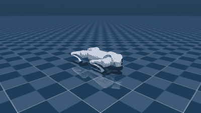
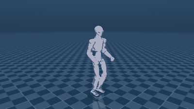
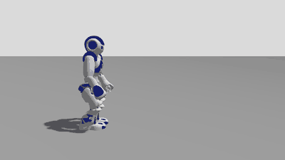
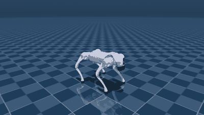
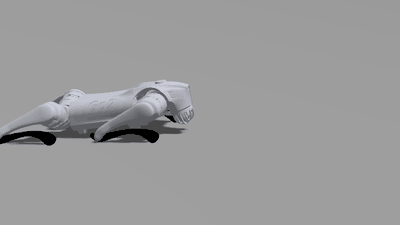
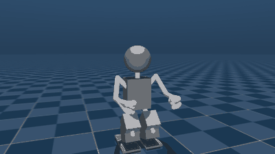

<h1 align="center"></h1>

ROS 2 framework for legged robots. One lifecycle node per robot runs a real-time cycle over
a shared robot state; the hardware, the motors, the sensors, the state estimator, the
controllers and the operation modes are pluginlib plugins selected and configured with ROS 2
parameters.

| Go2 (MuJoCo): stand up, trot, turn | R1 (MuJoCo): ZMP / LIPM walking | NAO (Gazebo): walking, with its meshes |
|:---:|:---:|:---:|
| [](docs/tutorials/go2_mujoco.md) | [](docs/tutorials/r1_mujoco.md) | [](docs/tutorials/nao_gazebo.md) |
| Go2 (MuJoCo): convex MPC | Go2 (Gazebo) | NAO (MuJoCo): head and arms from outside |
| [](docs/tutorials/go2_mujoco.md#6-convex-mpc) | [](docs/tutorials/go2_gazebo.md) | [](docs/tutorials/nao_mujoco.md#5-head-arms-and-legs-in-the-postures-from-outside) |

- **Robots**: Unitree **Go2** (quadruped) and **R1** (humanoid), plus the **NAO** (V6 motors)
  as a third robot added with its URDF, an SRDF and parameter files; it stands, walks and turns
  in MuJoCo and Gazebo.
- **Simulators**: **MuJoCo** (in the node, lockstep, publishes `/clock`) and **Gazebo**
  (gz-sim: a system plugin hosts the node, `ros_gz_sim` launch), plus the **unitree_sdk2 /
  DDS** path of the real robots.
- **ROS 2 native**: ament packages built with colcon, pluginlib, ROS 2 parameters
  (`robot_description`, `robot_description_semantic`), lifecycle node, topics, services, TF,
  `robot_state_publisher`, RViz, `joy`, `ros_gz_sim` / `ros_gz_bridge`, `osqp_vendor`.
- **Named poses in the SRDF** of each robot (`group_state`): the posture modes (stand up,
  stand down, sit, squat...) move between them.
- **Body relative commands**: `cmd_vel` (body twist) and `goal_pose` (the posture of the body
  while standing, a target to walk to while walking).
- **Kinematic and dynamic controllers**: gait with Raibert placement, ZMP / LIPM preview
  control for bipeds, convex MPC of the ground reaction forces for quadrupeds.
- **State estimation** with a Kalman filter of the base and the feet that also fuses
  **external odometries** (`nav_msgs/Odometry` topics, simulator ground truth, Unitree sport
  odometry).
- **Safety for the real robot**: dry run, joint limits, gain ramp, watchdog, remote with
  emergency stop.
- **Vendor interfaces in simulation**: the DDS interface of the Unitree robots and the ROS 2
  interface of naoqi_driver in front of the simulated robot, so programs written for the real
  robots run against MuJoCo and Gazebo unchanged.

## Tutorials

Step by step, each robot in each simulator and the real robots: build, launch arguments,
modes, postures, walking, the vendor interfaces, known issues ([all the tutorials](docs/tutorials/README.md)).

| Robot | MuJoCo | Gazebo | Real robot |
|---|---|---|---|
| Go2 | [Go2 in MuJoCo](docs/tutorials/go2_mujoco.md) | [Go2 in Gazebo](docs/tutorials/go2_gazebo.md) | [Go2 real and DDS simulator](docs/tutorials/go2_real.md) |
| R1 | [R1 in MuJoCo](docs/tutorials/r1_mujoco.md) | [R1 in Gazebo](docs/tutorials/r1_gazebo.md) | [R1 real](docs/tutorials/r1_real.md) |
| NAO | [NAO in MuJoCo](docs/tutorials/nao_mujoco.md) | [NAO in Gazebo](docs/tutorials/nao_gazebo.md) | — |

## Packages

| Package | Contents |
|---|---|
| `gaitos` | Metapackage: `params/gaitos.yaml` (common parameters), `params/fake.yaml`, `launch/gaitos.launch.py`. |
| `gaitos_msgs` | `srv/SetMode`, `msg/Status`. |
| `gaitos_common` | Types (`JointCommand`, `ImuData`, `Odometry`, `BaseState`, `ControlReference`...), `RobotState` (blackboard of the cycle), `Params` (view of the ROS 2 parameters, `package://` URIs), logging through rclcpp. |
| `gaitos_model` | URDF and SRDF parsing, `RobotModel` (joints in hardware order, legs, named poses), kinematics: forward, jacobians, damped least squares inverse kinematics, mimic joints, composite rigid body. |
| `gaitos_core` | Plugin interfaces (`HardwareInterface`, `JointActuatorBase`, `ImuSensorBase`, `ContactSensorBase`, `StateEstimatorBase`, `ControllerBase`, `OperationModeBase`), `PluginLoader` (pluginlib), gains. |
| `gaitos_hardware` | `FakeHardware` plugin: no physics, for tests and display. |
| `gaitos_actuators` | Motor plugins: `PdPassthrough`, `TorquePd`, `PositionServo`. |
| `gaitos_sensors` | `ImuPassthrough`, `ComplementaryImu`, `ForceThresholdContact`, `TorqueContact`. |
| `gaitos_estimators` | `KalmanEstimator`, `LegOdometryEstimator`, `ExternalOdometryEstimator`. |
| `gaitos_controllers` | Kinematic controllers: `JointPdController`, `StanceController`, `GaitController`. |
| `gaitos_dynamics` | Dynamic controllers: `LipmZmpController`, `ConvexMpcController` (OSQP). |
| `gaitos_modes` | `ModeManager` and the mode plugins: `ZeroTorqueMode`, `DampMode`, `PostureMode`, `BalanceStandMode`, `LocomotionMode`. |
| `gaitos_system` | `Gaitos` (the cycle and its safety), `GaitosNode` (lifecycle node) and the `gaitos_node` executable. |
| `gaitos_description` | `robots/<robot>_description/{urdf, srdf, config, mjcf}` (Go2, R1, NAO), `launch/display.launch.py`, RViz configuration, `scripts/make_gazebo_urdf.py` (physics URDF variant), `scripts/make_mjcf.py` (MJCF from it); fetches the Unitree meshes and MuJoCo assets (FetchContent) and, with `GAITOS_NAO_MESHES`, the NAO meshes. |
| `gaitos_mujoco` | `MujocoHardware` plugin, `launch/sim.launch.py`, `params/`, `snapshot` tool. |
| `gaitos_gazebo` | `gaitos_gz_system` plugin (hosts the node in gz-sim), worlds, `launch/sim.launch.py`, `params/`. |
| `gaitos_unitree` | `UnitreeGoHardware` (Go2) and `UnitreeHgHardware` (R1) plugins over unitree_sdk2 (FetchContent), `launch/robot.launch.py`, `params/`, `go2_dds_sim` tool. |
| `gaitos_naoqi_sim` | `NaoqiDriverEmulator` extension: the ROS 2 interface of naoqi_driver (`/joint_states`, `/odom`, `/cmd_vel`, `/joint_angles`, `/move_base_simple/goal`...) in front of a simulated gaitos NAO; `launch/sim.launch.py`, `params/nao_naoqi_sim.yaml`. |
| `naoqi_msgs/` | `naoqi_bridge_msgs`: the naoqi_driver interfaces (ros-naoqi naoqi_bridge_msgs2), fetched with FetchContent and generated here. |
| `gaitos_unitree_sim` | `UnitreeHgEmulator` (R1) and `UnitreeGoEmulator` (Go2) extensions: the DDS interface of the robot (`/lowstate`, `/sportmodestate`, `/api/sport`...) in front of a simulated gaitos, for programs written for the real robot; `launch/sim.launch.py`, `params/<robot>_unitree_sim.yaml`. |
| `unitree_ros2_msgs/` | `unitree_api`, `unitree_go`, `unitree_hg`: the unitree_ros2 messages, fetched with FetchContent and generated here. They are not needed by gaitos; they let `ros2 topic` read the robot topics. |

## Build

ROS 2 rolling (on this machine, in `/opt/ros/rolling`; Gazebo and OSQP come from its vendor
packages). Other dependencies: MuJoCo 3 (system). unitree_sdk2 is fetched by CMake
(FetchContent) when `gaitos_unitree` is configured, pinned to a commit (`UNITREE_SDK2_TAG`).

```bash
cd ~/ws/legged_ws
source /opt/ros/rolling/setup.bash
rosdep install --from-paths src --ignore-src -y          # ROS dependencies

colcon build --base-paths src --cmake-args -DCMAKE_BUILD_TYPE=Release
colcon test --base-paths src && colcon test-result --all
source install/setup.bash
```

Offline, or with a local copy of the SDK, add
`-DFETCHCONTENT_SOURCE_DIR_UNITREE_SDK2=<path to unitree_sdk2>`. The SDK's CycloneDDS 0.10
(`libddsc.so.0`, `libddscxx.so.0`) is installed in `lib/gaitos_unitree/unitree_sdk2` and found
through the RPATH, so it never shadows the CycloneDDS 11 of ROS.

The messages of unitree_ros2 are fetched the same way (`UNITREE_ROS2_TAG`,
`-DFETCHCONTENT_SOURCE_DIR_UNITREE_ROS2=<path>`).

The meshes and MuJoCo assets of the Unitree robots (BSD-3 by Unitree, not versioned with
gaitos) are fetched by `gaitos_description`: archives of pinned commits of unitree_ros and
unitree_mujoco (`UNITREE_ROS_TAG`, `UNITREE_MUJOCO_TAG`; about 1.8 GB unpacked in its build
folder, of which ~100 MB are installed). Local copies:
`-DFETCHCONTENT_SOURCE_DIR_UNITREE_ROS=<path> -DFETCHCONTENT_SOURCE_DIR_UNITREE_MUJOCO=<path>`;
without them (no MuJoCo, no meshes in RViz): `-DGAITOS_FETCH_ASSETS=OFF`.

## Quick start

### MuJoCo

```bash
ros2 launch gaitos_mujoco sim.launch.py robot:=go2 [rviz:=true] [real_time_factor:=1.0]
```

The robot starts lying in `damp`. From another terminal:

```bash
ros2 service call /go2/mode/stand_up std_srvs/srv/Trigger
ros2 service call /go2/set_mode gaitos_msgs/srv/SetMode "{mode: balance_stand}"
ros2 topic pub --once /go2/goal_pose geometry_msgs/msg/PoseStamped \
  "{header: {frame_id: base}, pose: {position: {z: -0.05}, orientation: {y: 0.07, w: 1.0}}}"
ros2 topic pub -r 10 /go2/cmd_vel geometry_msgs/msg/Twist "{linear: {x: 0.4}}"   # walks
ros2 topic pub --once /go2/goal_pose geometry_msgs/msg/PoseStamped \
  "{header: {frame_id: base}, pose: {position: {x: 1.0, y: 0.5}, orientation: {w: 1.0}}}"
ros2 service call /go2/mode/locomotion_mpc std_srvs/srv/Trigger                   # convex MPC
ros2 service call /go2/mode/stand_down std_srvs/srv/Trigger
ros2 topic echo /go2/status
```

`robot:=r1` starts the R1 standing; a `cmd_vel` in `balance_stand` starts the ZMP / LIPM
walking (`locomotion_lipm`).

### Gazebo

```bash
ros2 launch gaitos_gazebo sim.launch.py robot:=go2 [headless:=true] [rviz:=true]
ros2 launch gaitos_gazebo sim.launch.py robot:=r1      # world empty_fine (0.5 ms step)
```

The launch starts gz-sim through `ros_gz_sim`, spawns the robot with the `GaitosGzSystem`
plugin (which creates the gaitos node inside the simulator, stepped in lockstep, with the
motors as PD at every physics step), bridges `/clock` with `ros_gz_bridge` and runs
`robot_state_publisher`. The ROS interfaces are the same as with MuJoCo.

The simulated model is `urdf/<robot>_gazebo.urdf`, made by `make_gazebo_urdf.py` from the
URDF and `config/gazebo.yaml` with what the URDF lacks of the unitree_mujoco model: the
inertia (armature) and losses of the motors, both robots, and for the R1 the contact
geometry (feet boxes and spheres instead of meshes). Without the armature the torque control
of the convex MPC is unstable in Gazebo.

### Unitree robots

```bash
ros2 launch gaitos_unitree robot.launch.py robot:=go2 readonly:=true   # read only first
ros2 launch gaitos_unitree robot.launch.py robot:=go2 [network_interface:=eth0] [joy:=true]
ros2 launch gaitos_unitree robot.launch.py robot:=r1
```

The backends release the built-in sport / loco service (`release_sport_mode`), read
`rt/lowstate` and write `rt/lowcmd` (with its CRC) through unitree_sdk2; the motor drivers
close the PD of each command. `dds_sim:=true` uses interface `lo` and domain 1, the
setting of the [unitree_mujoco](https://github.com/unitreerobotics/unitree_mujoco) simulator
and of `go2_dds_sim`, a headless Go2 that speaks the same DDS topics:

```bash
ros2 run gaitos_unitree go2_dds_sim \
  $(ros2 pkg prefix gaitos_description)/share/gaitos_description/robots/go2_description/mjcf/scene.xml
ros2 launch gaitos_unitree robot.launch.py robot:=go2 dds_sim:=true
```

gaitos talks to the robot through unitree_sdk2 inside its node, so it works with any RMW.
It is tested with both FastDDS and `rmw_cyclonedds_cpp`. The node can load the CycloneDDS 0.10
bundled with unitree_sdk2 next to the CycloneDDS 11 used by the ROS RMW. With Cyclone, raise
the socket buffer as the RMW suggests: `sudo sysctl -w net.core.rmem_max=8388608`.

The unitree_ros2 messages (`unitree_go`, `unitree_hg`, `unitree_api`) are packages in
`unitree_ros2_msgs/`. They keep the names of unitree_ros2, because the package name gives the
DDS type names. To see the topics of the DDS simulator (domain 1 on
`lo`, without multicast), only list them, and read the limitation under Status before
subscribing:

```bash
ROS_DOMAIN_ID=1 CYCLONEDDS_URI='<CycloneDDS><Domain><General><Interfaces><NetworkInterface name="lo"/></Interfaces><AllowMulticast>false</AllowMulticast></General><Discovery><Peers><Peer address="127.0.0.1"/></Peers></Discovery></Domain></CycloneDDS>' \
  ros2 topic list --no-daemon   # /lowcmd, /lowstate
```

### Unitree robots in simulation (R1 and Go2)

The robot in MuJoCo or Gazebo with the DDS interface of the real one, so a ROS 2 program
written for the real robot (with the unitree_ros2 messages: unitree_r1 for the R1, a
SportClient over `/api/sport` for the Go2) runs on it unchanged. gaitos stands for Unitree's
controller: its modes are the FSM / sport modes and its walking the built-in gait.

```bash
export ROS_DOMAIN_ID=<free domain>   # these are the topic names of the real robot
ros2 launch gaitos_unitree_sim sim.launch.py robot:=r1|go2 [simulator:=mujoco|gazebo] [headless:=true] [bringup:=true]
```

The gaitos node runs in the namespace `gaitos` (`/gaitos/mode`, `/gaitos/status`,
`/gaitos/ground_truth`).

**R1** (`UnitreeHgEmulator`). `bringup:=true` also starts `r1_core` of unitree_r1 (r1_state,
robot_state_publisher, r1_locomotion, r1_gesture); gaitos leaves the robot state (TF,
joint_states, robot_description) to it (`publish_tf`, `publish.*` false, no
robot_state_publisher).

```bash
ros2 service call /r1/r1_locomotion/stand std_srvs/srv/Trigger     # FSM 4  -> stand_up
ros2 service call /r1/r1_locomotion/walk std_srvs/srv/Trigger      # FSM 811 -> balance_stand
ros2 topic pub -r 10 /r1/cmd_vel geometry_msgs/msg/Twist "{linear: {x: 0.3}}"
```

| Robot interface | Emulated as |
|---|---|
| `/lowstate` (`unitree_hg/LowState`, 500 Hz) | joints in the documented motor slots (`motor_index`), IMU, tick |
| `/odommodestate` (`unitree_go/SportModeState`) | the gaitos estimate |
| `/secondary_imu`, `/lf/bmsstate`, `/arm/action/state` | the IMU, a full battery, nothing holding |
| `/api/sport`: GetFsmId, SetFsmId | gaitos mode ↔ FSM (`fsm.*`): 0 `zero_torque`, 1 `damp`, 4 `stand_up`, 811 `balance_stand` / `locomotion_lipm` |
| `/api/sport`: SetVelocity | body twist kept for its `duration`, only in FSM 811 |
| `/api/arm` | empty action list; the actions answer 3203 (not implemented) |

Not emulated yet: `arm_sdk` (arms while walking), the Dex3 hands. The walking is the gaitos
LIPM: unitree_r1 asks for at least 0.3 m/s, the controller caps it at 0.15 m/s.

**Go2** (`UnitreeGoEmulator`). gaitos also publishes its own state in `/gaitos` (TF,
joint_states, robot_state_publisher). The sport service takes the JSON of the official
SportClient (checked against unitree_sdk2): `{"x", "y", "z"}` for Euler and Move,
`{"data"}` for the rest.

| Robot interface | Emulated as |
|---|---|
| `/lowstate`, `/lf/lowstate` (`unitree_go/LowState`, 500 / 20 Hz) | motors in the model order (FR, FL, RR, RL × hip, thigh, calf), IMU, foot forces, a full battery |
| `/sportmodestate`, `/lf/sportmodestate` (`unitree_go/SportModeState`, 200 / 20 Hz) | the gaitos estimate, sport mode (`sport_modes.*`: 1 balance stand, 3 locomotion, 5 lie down, 6 joint lock, 7 damping, 8 recovery, 10 sit), gait, feet in the body frame and their forces |
| `/api/sport` 1001 Damp, 1002 BalanceStand, 1004 StandUp, 1005 StandDown, 1006 RecoveryStand, 1009 Sit, 1010 RiseSit | a gaitos mode each (`api.*`) |
| `/api/sport` 1008 Move, 1003 StopMove | body twist kept for `move_timeout` (1 s), in balance stand or walking |
| `/api/sport` 1007 Euler | body roll, pitch, yaw while in balance stand |
| `/api/sport` 1015 SpeedLevel, 1027 SwitchJoystick, 1028 Pose | accepted, no effect |
| `/api/sport` tricks and other gaits (Hello, dances, flips, ClassicWalk...) | 3203 (not implemented) |

Every service also answers the internal ids 1 (api version, `1.0.0.1`) and 2 (no-op) of
unitree_sdk2. Neither emulator fills the CRC of `lowstate`.

Programs built on unitree_sdk2 itself (its bundled CycloneDDS 0.10.2) cannot talk to the
emulator: that CycloneDDS crashes (`ddsi_xt_type_init_impl with invalid type object`) as soon
as it discovers the endpoints of a current ROS 2 middleware (CycloneDDS 11 or Fast DDS, both
tried). They need the ROS 2 messages (unitree_ros2) instead.

### NAO in simulation behind naoqi_driver

The NAO in MuJoCo or Gazebo with the ROS 2 interface of naoqi_driver, so a program written for
the real NAO through naoqi_driver runs on it unchanged. gaitos stands for NAOqi ALMotion: its
posture modes, its stance and its walk.

```bash
export ROS_DOMAIN_ID=<free domain>   # these are the topic names of naoqi_driver
ros2 launch gaitos_naoqi_sim sim.launch.py [simulator:=mujoco|gazebo] [headless:=true] [rviz:=true]
ros2 service call /gaitos/mode/stand_init std_srvs/srv/Trigger     # NAOqi wakeUp (it starts in crouch)
ros2 topic pub --once /joint_angles naoqi_bridge_msgs/msg/JointAnglesWithSpeed \
  "{joint_names: [HeadYaw, HeadPitch], joint_angles: [0.5, 0.2], speed: 0.2}"
ros2 topic pub --once /cmd_vel geometry_msgs/msg/Twist "{linear: {x: 0.05}}"   # holds until a zero twist
ros2 topic pub --once /move_base_simple/goal geometry_msgs/msg/PoseStamped \
  "{header: {frame_id: base_footprint}, pose: {position: {x: 0.3}, orientation: {w: 1.0}}}"
```

| naoqi_driver | Emulated as |
|---|---|
| `/joint_states` (50 Hz) | the 26 joints of the body (RHipYawPitch from LHipYawPitch); a robot_state_publisher at the root namespace publishes the link TF |
| TF `odom → base_link → base_footprint`, `/odom` (15 Hz), `/imu/torso` (10 Hz) | the gaitos estimate; base_footprint on the ground under the torso |
| `/cmd_vel` (ALMotion.move) | the velocity holds until the next message; only standing (from stand_init it enters balance_stand) |
| `/joint_angles` (setAngles / changeAngles) | `Gaitos::set_joint_targets`: names or one chain (Body, Head, LArm, RArm, LLeg, RLeg), speed as a fraction of the max speed; head and arms always, any joint in the posture modes |
| `/move_base_simple/goal` (moveTo, `odom` or `base_footprint`) | the walk with a pose goal |
| `/speech` | logged |

Not emulated: cameras, sonars, bumpers, touch sensors, audio, info, diagnostics. NAOqi
wakeUp / rest are the gaitos modes `stand_init` / `crouch` (`/gaitos/mode/<name>`).

### Display

```bash
ros2 launch gaitos_description display.launch.py robot:=r1 pose:=squat
```

gaitos on `FakeHardware` (no physics) in an SRDF pose, with `robot_state_publisher` and RViz;
the posture modes move it.

## ROS 2 interfaces

One `gaitos_node` per robot, named `gaitos`, in the namespace of the robot (`/go2`...).

| Kind | Name | Type | |
|---|---|---|---|
| Subscription | `cmd_vel` | `geometry_msgs/Twist` | Body twist (x forward, y left, yaw rate). Refresh at ≥ 2 Hz; it stops after `command_timeout`. |
| Subscription | `goal_pose` | `geometry_msgs/PoseStamped` | Relative to the body (`frame_id` the base frame or empty) or in `odom`. Standing: body posture; walking: target. |
| Subscription | `external_odometry.topics[i]` | `nav_msgs/Odometry` | External odometry `external_odometry.sources[i]`, fused by the estimator. |
| Subscription | `joy` | `sensor_msgs/Joy` | Remote (`teleop.joy.enabled`). |
| Subscription | `joint_targets` | `sensor_msgs/JointState` | Positions (and max speeds in `velocity`) of joints moved over the controller: the joints of `external_joints.groups`, any joint in `external_joints.any_joint_modes`; a mode change drops them. |
| Service | `set_mode` | `gaitos_msgs/SetMode` | Request a mode. |
| Service | `mode/<name>` | `std_srvs/Trigger` | One per mode. |
| Publisher | `mode` | `std_msgs/String` | Active mode (transient local). |
| Publisher | `status` | `gaitos_msgs/Status` | Mode, controller, contacts, foot forces, dry run, last safety event. |
| Publisher | `odometry` | `nav_msgs/Odometry` | Estimate of the base (`odom` → base frame). |
| Publisher | `joint_states` | `sensor_msgs/JointState` | For `robot_state_publisher`. |
| Publisher | `ground_truth` | `nav_msgs/Odometry` | Simulators. |
| TF | `odom` → base | | `publish_tf`; frames `frames.odom`, `frames.base`, `frames.prefix`. |
| Publisher | `/clock` | `rosgraph_msgs/Clock` | MuJoCo (`publish_clock`). |

The node is a lifecycle node: `gaitos_node` configures and activates itself (`autostart`,
default true); configure loads the model and every plugin, activate starts the hardware and
the real-time loop thread, deactivate leaves the robot in the safe mode.

`publish.joint_states`, `publish.odometry` and `publish_tf` (default true) turn off the robot
state when another stack publishes it. Extensions (`gaitos::NodeExtension`, pluginlib) add
more ROS interfaces to the node in front of the same gaitos, configured as
`extensions.<name>.plugin` plus their own parameters (e.g. `gaitos_unitree_sim`).

## Architecture

```text
hardware.read -> remote/teleop -> safety -> imu -> contacts -> estimator -> mode requests
  -> mode -> controller -> gain ramp -> actuators -> hardware.write
```

| Stage | Interface (pluginlib base class) | Writes in `RobotState` |
|---|---|---|
| Hardware | `gaitos::HardwareInterface` | `joints`, `imu_raw`, `foot_force_raw`, `remote`, `external_odometry` |
| IMU | `gaitos::ImuSensorBase` | `imu` |
| Contacts | `gaitos::ContactSensorBase` | `contacts` |
| Estimator | `gaitos::StateEstimatorBase` | `base` |
| Mode | `gaitos::OperationModeBase` (through `ModeManager`) | `mode`, `reference` |
| Controller | `gaitos::ControllerBase` (the one the mode selects) | `command` |
| Actuators | `gaitos::JointActuatorBase` (one per joint group) | `motor_command` |

The cycle runs in its own thread (`real_time`: SCHED_FIFO, locked memory, CPU affinity),
or is stepped by the host (the Gazebo plugin). Subscriptions, services and the publish
timer run in the ROS executor; they talk to the cycle through a thread safe command queue
and a snapshot of the state, so the cycle never blocks on ROS. Every joint command has the
Unitree motor format, `tau = kp (q* - q) + kd (dq* - dq) + tau_ff`.

## Operation modes

The modes follow the Unitree documentation: the Go2 sport service
(`unitree/robot/go2/sport/sport_api.hpp`: Damp, BalanceStand, StopMove, StandUp, StandDown,
RecoveryStand, Euler, Move, Sit...) and the R1 loco FSM
(`unitree/robot/r1/loco/r1_loco_client.hpp`: ZeroTorque 0, Damp 1, Squat 2, StandUp 4,
Start 811...). These are the ones of the Go2:

| Mode | Plugin / controller | Unitree | Does |
|---|---|---|---|
| `zero_torque` | `ZeroTorqueMode` / joint | ZeroTorque | Every joint passive. |
| `damp` | `DampMode` / joint | Damp | Damping only; the safe mode. |
| `stand_up` | `PostureMode` (`stand`) / joint | StandUp | To the `stand` pose, joints locked. |
| `stand_down` | `PostureMode` (`stand_low`, `lie`) / joint | StandDown | Lies down. |
| `recovery_stand` | `PostureMode` (`lie`, `stand`) → `balance_stand` | RecoveryStand | From lying (or damped) to balanced standing. |
| `sit` | `PostureMode` (`sit`) / joint | Sit | Sits (only from standing). |
| `balance_stand` | `BalanceStandMode` / stance | BalanceStand + Euler | Body pose from `goal_pose`; a `cmd_vel` switches to `locomotion`. |
| `locomotion` | `LocomotionMode` / gait | Move | Body twist, or walk to a body relative goal. |
| `locomotion_mpc` | `LocomotionMode` / mpc | Move | The same with the convex MPC. |

The R1 has `zero_torque`, `damp`, `stand_up`, `squat`, `balance_stand`, `locomotion_lipm`
(Start + SetVelocity, where `balance_stand` goes on a twist) and `locomotion` (kinematic
gait); the NAO `stand_init`, `crouch` and `balance_stand` (NAOqi postures).

Mode rules (parameters of each mode): `allowed_from`, `next` (mode when it finishes),
`on_twist`, `controller`. The safe mode (`damp`) is entered on fall detection
(`safety.max_tilt`), on a failed mode, on a failed controller, on joint limits, on the
remote emergency stop or after `max_hardware_failures` failed reads.

### Poses in the SRDF

Named poses are `group_state` elements of the SRDF (`robot_description_semantic`). States
with the same name in different groups are merged into one whole-body pose; joints not in a
pose keep their position. The SRDF also defines the legs (one chain group per leg) and, with
its `all` group, the joint order (the motor order of the hardware).

| Robot | Poses |
|---|---|
| Go2 | `stand`, `stand_low`, `lie`, `sit`, `stretch` (stand and lie from the SDK2 `go2_stand_example`) |
| R1 | `zero`, `stand`, `squat` |
| NAO | `stand_init`, `stand_zero`, `crouch` |

## Parameters

Launch files load, in order (later files override earlier ones):

1. `gaitos/params/gaitos.yaml`: loop, real time, defaults of the plugins, safety;
2. `gaitos_description/robots/<robot>_description/config/<robot>.yaml`: model, plugins,
   controllers and modes of the robot;
3. the backend file: `gaitos_mujoco/params/<robot>_mujoco.yaml`,
   `gaitos_gazebo/params/<robot>_gazebo.yaml`, `gaitos_unitree/params/<robot>_unitree*.yaml`,
   `gaitos/params/fake.yaml`;
4. `robot_description` and `robot_description_semantic` (URDF and SRDF text), as for
   `robot_state_publisher` and MoveIt; without them, `robot.urdf` / `robot.srdf` paths or
   `package://` URIs are read.

| Block | Contents |
|---|---|
| `robot` | `name`, `base_link`, `joints` (order), `legs.names`, `legs.groups`, `legs.orientation_ik`. |
| `frequency`, `real_time`, `real_time_factor` | Loop rate; SCHED_FIFO, memory locking, CPU affinity; simulation speed. |
| `hardware` | Backend plugin and its parameters. |
| `actuators.<name>` | Actuator plugins, each with its `joints` (names, `all`, `legs`, `upper_body` or SRDF groups). |
| `imu`, `contacts`, `estimator` | One plugin each. |
| `controllers.<name>` | Controllers (`joint` is always there). |
| `modes.<name>`, `initial_mode` | Operation modes. |
| `safety`, `teleop`, `dry_run` | Safety (below). |
| `external_odometry.sources`, `.topics` | External odometry topics. |
| `frames.*`, `publish_tf`, `publish_rate`, `publish_clock` | ROS outputs. |

Gains are given per joint, per group or by default (`default`, then groups, then joints):
`gains: {default: {kp: 40, kd: 1}, legs: {kp: 60, kd: 3}, FR_calf_joint: {kp: 80}}`.
ROS 2 parameters have no lists of maps, so sequences are parallel lists (`legs.names` /
`legs.groups`, `poses` / `durations`, `teleop.buttons` / `teleop.modes`).

## Plugins

| Interface | Plugins |
|---|---|
| `gaitos::HardwareInterface` | `gaitos_hardware/FakeHardware`, `gaitos_mujoco/MujocoHardware`, `gaitos_unitree/UnitreeGoHardware`, `gaitos_unitree/UnitreeHgHardware` (Gazebo: provided by its system plugin) |
| `gaitos::JointActuatorBase` | `gaitos_actuators/PdPassthrough`, `gaitos_actuators/TorquePd`, `gaitos_actuators/PositionServo` |
| `gaitos::ImuSensorBase` | `gaitos_sensors/ImuPassthrough`, `gaitos_sensors/ComplementaryImu` |
| `gaitos::ContactSensorBase` | `gaitos_sensors/ForceThresholdContact`, `gaitos_sensors/TorqueContact` |
| `gaitos::StateEstimatorBase` | `gaitos_estimators/KalmanEstimator`, `gaitos_estimators/LegOdometryEstimator`, `gaitos_estimators/ExternalOdometryEstimator` |
| `gaitos::ControllerBase` | `gaitos_controllers/JointPdController`, `gaitos_controllers/StanceController`, `gaitos_controllers/GaitController`, `gaitos_dynamics/LipmZmpController`, `gaitos_dynamics/ConvexMpcController` |
| `gaitos::OperationModeBase` | `gaitos_modes/ZeroTorqueMode`, `DampMode`, `PostureMode`, `BalanceStandMode`, `LocomotionMode` |
| `gaitos::NodeExtension` (ROS interfaces of the node) | `gaitos_unitree_sim/UnitreeHgEmulator`, `gaitos_unitree_sim/UnitreeGoEmulator`, `gaitos_naoqi_sim/NaoqiDriverEmulator` |

### Writing a plugin

```cpp
#include "gaitos_core/ControllerBase.hpp"
#include "pluginlib/class_list_macros.hpp"

namespace my_controllers
{
class WbcController : public gaitos::ControllerBase
{
public:
  bool update(const gaitos::RobotState & state, const gaitos::ControlReference & ref,
    double dt, gaitos::JointCommand & command) override;

protected:
  bool on_initialize() override
  {
    weight_ = params().get<double>("weight", 1.0);   // controllers.<name>.weight
    return true;
  }
  double weight_{1.0};
};
}  // namespace my_controllers

PLUGINLIB_EXPORT_CLASS(my_controllers::WbcController, gaitos::ControllerBase)
```

```xml
<!-- plugins.xml -->
<library path="my_controllers">
  <class name="my_controllers/WbcController" type="my_controllers::WbcController"
         base_class_type="gaitos::ControllerBase">
    <description>Whole body controller</description>
  </class>
</library>
```

```cmake
find_package(gaitos_core REQUIRED)
add_library(my_controllers SHARED src/WbcController.cpp)
target_link_libraries(my_controllers gaitos_core::gaitos_core)
pluginlib_export_plugin_description_file(gaitos_core plugins.xml)
```

```yaml
controllers:
  wbc: {plugin: my_controllers/WbcController, weight: 2.0}
modes:
  locomotion: {plugin: gaitos_modes/LocomotionMode, controller: wbc}
```

### Kinematic controllers (`gaitos_controllers`)

- **`StanceController`**: all feet on the ground at the nominal stance of an SRDF pose; the
  body moves over them following `body_offset` and `body_rpy` (limited in value and rate),
  solved with inverse kinematics (6D for legs with `orientation_ik`).
- **`GaitController`**: periodic gait for any number of legs (`gaits.<name>.offsets`,
  `period`, `duty`, `step_height`): stance feet move against the body twist, swing feet
  follow a cycloid to the Raibert touchdown point; a PI loop on the estimated body velocity
  (`velocity_feedback`), attitude feedback and lateral sway (bipeds).

### Dynamic controllers (`gaitos_dynamics`)

- **`LipmZmpController`** (bipeds), after Kajita et al., ICRA 2003: footstep planner from
  the body twist; ZMP reference from sole to sole; preview control of the cart-table model
  (discrete Riccati equation) for the CoM; cycloid swing foot; 6D inverse kinematics of the
  legs. Feedforward of the LIPM ground reaction at the center of pressure
  (τ = −Jᵀ [F; M], `feedforward`); DCM stabilizer moving the center of pressure with the
  error of the measured DCM (`dcm_feedback`, ankle strategy); heading recovery
  (`heading_gain`, `heading_body_gain`); attitude feedback.
- **`ConvexMpcController`** (quadrupeds), after Di Carlo et al., IROS 2018: single rigid body
  with the composite inertia of the URDF, linearized around the yaw, condensed QP on the
  ground reaction forces with friction pyramids and normal force bounds, solved with OSQP
  (`osqp_vendor`, warm started); stance legs apply τ = −Jᵀ Rᵀ f, swing legs follow the
  Raibert footstep with joint PD. To stop, the gait goes on until every foot is in stance and
  on the ground (measured contact), and then all the legs stop together; stopped, the legs
  hold that posture with `gains.standing` under the MPC forces.

### State estimation

`KalmanEstimator`: base position and velocity plus every foot (world frame); IMU prediction;
corrections with leg kinematics, zero velocity of the stance feet and their height
(`ground_height`); orientation from the IMU, yaw corrected by external sources.

```yaml
external_odometry: {sources: [mocap], topics: [/mocap/odom]}   # nav_msgs/Odometry topics
estimator:
  plugin: gaitos_estimators/KalmanEstimator
  external:
    mocap: {position: true, yaw: true, position_noise: 0.01, align: true, gate: 11.3}
```

Sources: topics as above, `ground_truth` (simulators), `unitree_sport` (Go2 sport odometry).

## Safety and the real robot

| Protection | Parameters | Does |
|---|---|---|
| Read only | `dry_run` (`readonly:=true`) | Everything runs but the hardware is never written, not even on exit or by the watchdog. |
| Joint limits | `safety.limits` | Position beyond the URDF limits + margin, speed or measured torque over a scale of the limits → safe mode. |
| Gain ramp | `safety.gain_ramp_time` | Leaving `damp` / `zero_torque`, kp and feedforward rise from 0. |
| Watchdog | `safety.watchdog_timeout` | If the cycle stalls, another thread calls the hardware `emergency_stop()` (damped joints). |
| Remote | `teleop` | Unitree wireless controller (`LowState.wireless_remote`) or `sensor_msgs/Joy` (`teleop.joy`): emergency stop `L2+B`, modes on button combinations, twist from the sticks. |
| Falls | `safety.max_tilt` | Tilt over the limit → safe mode. |

The Unitree parameter files enable the ramp (1.5 s), the watchdog (0.1 s) and the remote
(Go2: `L2+A` stand_up, `L2+X` stand_down, `L1+A` recovery_stand, `START` balance_stand,
`R2+A` locomotion, `R2+X` locomotion_mpc; R1: `L2+A` stand_up, `L2+X` squat, `START`
balance_stand, `R2+A` locomotion_lipm).

Suggested sequence: (1) the DDS simulator; (2) read only with the robot hanging or lying:
check joints and signs (`/go2/joint_states`), IMU, foot forces and remote
(`/go2/status`); (3) hanging, passive modes and `stand_up` with reduced gains; (4) on the
ground, standing and small pose goals; (5) walking slowly; the R1 with a harness. The R1
LIPM gains (kp 600) come from simulation: check them against the motors.

## Robots

| | Go2 | R1 | NAO |
|---|---|---|---|
| Joints | 12 | 26 | 25 actuated (`RHipYawPitch` mimics `LHipYawPitch`) |
| URDF | unitree_ros `go2_description` (+ Gazebo variant) | unitree_ros `r1_description` (+ Gazebo variant) | ros-naoqi `nao_robot` (V5 kinematics and masses, V6 motor limits; + simulation variant) |
| MuJoCo model | unitree_mujoco `go2` | unitree_mujoco `r1` | `make_mjcf.py` from the simulation variant |
| Motors | `PdPassthrough` | `PdPassthrough` | `PositionServo` (stiffness 0..1; in simulation a PD servo, `servo: {kp, kd}`) |
| Contacts | foot_force / simulator forces | joint torques (real), simulator forces | FSR (simulator forces) |
| Backends | MuJoCo, Gazebo, unitree_sdk2 | MuJoCo, Gazebo, unitree_sdk2 | MuJoCo, Gazebo, `FakeHardware` (NAOqi backend to be written) |

**NAO.** `ros2 launch gaitos_mujoco sim.launch.py robot:=nao` (or `gaitos_gazebo`, 0.5 ms
world). It starts in `crouch`; `mode/stand_init`, `mode/balance_stand` (body posture with
`goal_pose` in `torso`, relative to the body), `mode/locomotion` (a `cmd_vel` in
balance_stand starts it) and `mode/crouch`.

- Walking: the kinematic `GaitController` (alternating steps, 0.6 s, 2 cm of sway, velocity PI
  loop): ≈0.06 m/s and 0.3 rad/s. The LIPM / ZMP controller is not used on the NAO: its
  stabilizer acts through a torque feedforward that position servos do not have, and its
  massless legs model does not suit the NAO (legs ≈45 % of the mass).
- Turning: both legs share the HipYawPitch motor (on mirrored 45° axes), so the feet can only
  turn against each other relative to the torso. `LegIk` solves legs that share joints
  together, leaving free the yaw common to every foot, and the gait plans the yaw of the feet;
  the body turns over the stance foot.
- Joints over the controller (`external_joints`): head and arms always, any joint in the
  posture modes (`joint_targets`, naoqi_driver `/joint_angles`).

- Simulation model: `config/gazebo.yaml` → `urdf/nao_gazebo.urdf` (`make_gazebo_urdf.py`:
  primitive collisions with the soles from the FSR frames, no Gazebo classic plugins, links
  renamed where they clash with a joint name in SDF, no `<mimic>`) → `mjcf/nao.xml`
  (`make_mjcf.py` with `config/mujoco.yaml`: free base, IMU at the torso accelerometer, a motor
  per joint with the torque limit of the URDF). Neither needs the meshes.
- Joint limits of the URDF: the NAO V6 motors (doc.aldebaran.com 2-8, motors_naov6): torque =
  stall torque × reduction (e.g. 8.5 N·m for the pitch joints of the legs, 13.1 N·m for
  HipYawPitch, HipRoll and AnkleRoll), speed = no-load speed / reduction.
- Mimic joints (`RHipYawPitch`, which shares the motor of `LHipYawPitch`, and the fingers,
  which follow `LHand` / `RHand`): both simulator backends drive them to follow the command of
  their master.
- Servos: the commanded stiffness (0..1, NAOqi) scales a PD of `servo.kp` / `servo.kd`:
  200 N·m/rad and 1.0 N·m·s/rad in MuJoCo, 60 and 0.8 in Gazebo (stiffer servos make the feet
  bounce on its contacts; softer ones in MuJoCo give speed spikes the joint limits stop).
- Meshes (looks only, RViz and Gazebo): `-DGAITOS_NAO_MESHES=ON` downloads the nao_meshes
  installer of ros-naoqi and installs them in `robots/nao_description/meshes`. **Their license
  is not that of gaitos: Creative Commons BY-NC-ND 4.0** (`robots/nao_description/MESHES_LICENSE.md`,
  installed next to them); building with that option means accepting it.

Adding a robot: URDF (+ meshes), SRDF (legs, `all` group, poses), a parameter file in
`gaitos_description/robots/<robot>_description/config/`, and a backend (MuJoCo with an
MJCF or the URDF, Gazebo with the URDF, or a new `HardwareInterface` plugin).

## Status

Verified on this machine with ROS 2 rolling (`colcon test`: 64 tests, plus launch runs):

- Go2, `ros2 launch gaitos_mujoco sim.launch.py`: mode services, `cmd_vel` walking (2.4 m),
  odometry vs ground truth (2.21 vs 2.41 m), status, TF with `robot_state_publisher`.
  In the tests: stand up, body pose, trot following vx, vy and wz, sit, goal relative to
  the body, convex MPC walking and turning.
- Go2, `ros2 launch gaitos_gazebo sim.launch.py`: node inside gz-sim, services, `cmd_vel`
  walking, `/clock`, the whole MuJoCo sequence of the quick start (body pose, walking, goal
  relative to the body, convex MPC walking and stopping, stand down).
- Go2, `ros2 launch gaitos_unitree robot.launch.py dds_sim:=true` against `go2_dds_sim`:
  stand up and walk through unitree_sdk2; read only sends no command.
- R1: MuJoCo stand, body pose, squat and LIPM walking (forward ≤ 0.15 m/s, turning);
  Gazebo (0.5 ms world) stand and LIPM walking (≈1 m in the launch run, longer walks still
  fall after 15–20 s).
- NAO in MuJoCo and Gazebo: from `crouch` (torso at 0.23 m) to `stand_init` (0.32 m), steady in
  `balance_stand` with body posture, and back to `crouch` (test `NaoStandsFromCrouch` in MuJoCo).
  Walking forward ≈0.06 m/s and turning in place 0.33 rad/s (test `NaoWalks`); Gazebo walked
  0.8 m in 14 s.
- NAO behind naoqi_driver (`gaitos_naoqi_sim`), MuJoCo and Gazebo, driven by a client of the
  naoqi_driver topics: `/joint_states` (26 joints), `/imu/torso`, `/joint_angles` (setAngles to
  (0.5, 0.2) reached, changeAngles −0.3), `/cmd_vel` 0.05 m/s for 8 s (0.36–0.41 m) and stop,
  `/move_base_simple/goal` 0.2 m ahead (0.18–0.195 m), TF odom → base_link → base_footprint and
  the links.
- Go2 emulated (`gaitos_unitree_sim robot:=go2`), MuJoCo and Gazebo, driven by a client of
  the SportClient protocol: StandUp, BalanceStand, Euler (pitch 0.2), Move 0.4 m/s (2.3 m in
  6 s), turning, StopMove, Sit, RiseSit, StandDown, Damp, with the sport mode of
  `/sportmodestate` following (7, 6, 1, 3, 10, 1, 5, 7) and `/lowstate` at 500 Hz.
- unitree_r1 against the emulated R1 (`gaitos_unitree_sim`, `bringup:=true`), MuJoCo and
  Gazebo: r1_state publishes joint_states and odometry from `/lowstate` (500 Hz) and
  `/odommodestate`, r1_locomotion changes FSM (stand, walk, damp) and walks with `cmd_vel`
  (0.85 m in MuJoCo, 0.90 m in Gazebo in 10 s, odometry within 3 cm of the ground truth).

Limitations:

- R1 walking: forward up to 0.15 m/s and turning; faster or lateral walking falls. It needs
  stiffer legs than the SDK2 example (kp 600).
- Not tested on the real robots.
- CycloneDDS 11 (ROS rolling) vs 0.10 (unitree_sdk2): a ROS 2 subscriber on an SDK topic
  (`ros2 topic echo /lowstate` or `/lowcmd` with the unitree_ros2 messages) makes the
  CycloneDDS 0.10 side crash with a segfault (`ddsi_xt_type_init_impl with invalid type
  object`). That side is the gaitos node itself or `go2_dds_sim`, and could be the robot's
  services. Listing topics is safe, and so is gaitos sharing the domain without such
  subscribers. With the robot, use a `ROS_DOMAIN_ID` other than 0. `robot.launch.py` warns
  when it is 0.
- NAO: no NAOqi / LoLA backend for the real robot yet; walking only on flat ground, slower
  than NAOqi's walk, and `moveTo` stops a little short of the goal (≈1–2 cm).

The clips (`docs/media`) are made with the tools in `docs/tools`: `record_mujoco.sh` (the
`gaitos_mujoco snapshot` tool, offscreen EGL rendering of a scripted run, `--frames` for
sequences), `record_gazebo.sh` (a fixed camera added to the world, its images bridged to ROS and
saved) and `make_gif.py`. Each tutorial ends with the command of its clips.

## License

Apache 2.0. The robot models come from
[unitree_ros](https://github.com/unitreerobotics/unitree_ros) and
[unitree_mujoco](https://github.com/unitreerobotics/unitree_mujoco) (BSD-3-Clause, Unitree
Robotics) and [nao_robot](https://github.com/ros-naoqi/nao_robot) (BSD). The NAO meshes,
downloaded only with `GAITOS_NAO_MESHES=ON`, are © SoftBank Robotics under CC BY-NC-ND 4.0.
