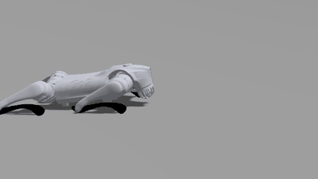

# Go2 in Gazebo

[← Tutorials](README.md)

The Unitree Go2 in Gazebo (gz-sim). A system plugin (`GaitosGzSystem`) creates the gaitos node
inside the simulator and steps it with the physics; the motors are a PD closed at every
physics step, as the motor drivers do. Model: the URDF of `unitree_ros` with the motor inertia
and losses of the MuJoCo model (`urdf/go2_gazebo.urdf`).

| Stand up, trot and turn |
|:---:|
|  |
| stand_up → balance_stand → 0.3 m/s → 0.8 rad/s → stop |

## 1. Before starting

```bash
cd ~/ws/legged_ws
source install/setup.bash
export ROS_DOMAIN_ID=10
```

## 2. Launch

```bash
ros2 launch gaitos_gazebo sim.launch.py robot:=go2                  # with the Gazebo window
ros2 launch gaitos_gazebo sim.launch.py robot:=go2 headless:=true   # without window
ros2 launch gaitos_gazebo sim.launch.py robot:=go2 rviz:=true       # and RViz
```

| Argument | Default | |
|---|---|---|
| `robot` | `go2` | |
| `world` | `empty` (1 ms step) | `empty_fine` (0.5 ms) or the path of an SDF world |
| `headless` | `false` | server only (no window) |
| `x`, `y`, `z`, `yaw` | 0, 0, 0.25, 0 | spawn pose |
| `namespace` | the robot name | |
| `rviz` | `false` | |
| `params` | | extra parameter files, comma separated |
| `robot_state_publisher` | `true` | |

The launch starts gz-sim through `ros_gz_sim`, spawns the robot with the plugin, bridges
`/clock` (`ros_gz_bridge`) and runs `robot_state_publisher`. The robot starts **lying, in
`damp`** (joints set by `JointPositionReset`).

## 3. Modes, posture and walking

The ROS interface is the same as in MuJoCo:

```bash
ros2 service call /go2/mode/stand_up std_srvs/srv/Trigger
ros2 service call /go2/mode/balance_stand std_srvs/srv/Trigger
ros2 topic pub --once /go2/goal_pose geometry_msgs/msg/PoseStamped \
  "{header: {frame_id: base}, pose: {position: {z: -0.05}, orientation: {y: 0.07, w: 1.0}}}"
ros2 topic pub -r 10 /go2/cmd_vel geometry_msgs/msg/Twist "{linear: {x: 0.3}}"     # trot
ros2 topic pub -r 10 /go2/cmd_vel geometry_msgs/msg/Twist "{angular: {z: 0.8}}"    # turn
ros2 topic pub --once /go2/goal_pose geometry_msgs/msg/PoseStamped \
  "{header: {frame_id: base}, pose: {position: {x: 1.0, y: 0.5}, orientation: {w: 1.0}}}"
ros2 service call /go2/mode/locomotion_mpc std_srvs/srv/Trigger                   # convex MPC
ros2 service call /go2/mode/sit std_srvs/srv/Trigger
ros2 service call /go2/mode/stand_down std_srvs/srv/Trigger
ros2 topic echo /go2/status
```

The modes are explained in [Go2 in MuJoCo](go2_mujoco.md#3-stand-up-and-the-postures). Verified in
Gazebo: the whole sequence above (posture, walking, goal relative to the body, MPC walking and
stopping, sit, stand down).

## 4. A program for the real Go2 against this simulation

```bash
ros2 launch gaitos_unitree_sim sim.launch.py robot:=go2 simulator:=gazebo [headless:=true]
```

The same emulated DDS interface as in [MuJoCo](go2_mujoco.md#8-a-program-for-the-real-go2-against-this-simulation):
`/lowstate`, `/sportmodestate`, `/api/sport` (StandUp, BalanceStand, Move, Euler, Sit...).

## 5. Remake the clip

```bash
GIF_OPTS="--skip 11" CAM="1.2 -3.0 0.9 0 0.15 1.5708" docs/tools/record_gazebo.sh go2 empty \
  docs/media/go2_gazebo_walk.gif wait:14 mode:stand_up wait:4 mode:balance_stand wait:1.5 \
  vel:0.3,0,0 wait:6 vel:0,0,0.8 wait:3 stop wait:2
```

(`CAM`: pose of a fixed camera added to the world; the frames are cropped around the robot.)
