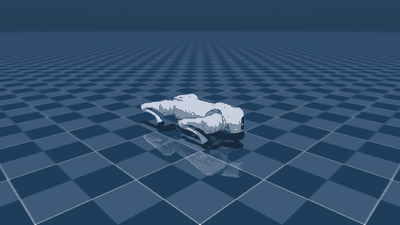
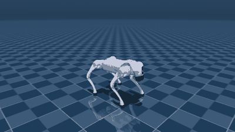
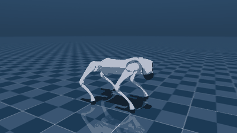

# Go2 in MuJoCo

[← Tutorials](README.md)

The Unitree Go2 in MuJoCo, run inside the gaitos node (lockstep: every gaitos cycle advances
the physics). Model: `unitree_mujoco` `go2` (meshes and assets fetched by
`gaitos_description`).

| Walking (`locomotion`, kinematic trot) | Convex MPC (`locomotion_mpc`) | Postures and body pose |
|:---:|:---:|:---:|
|  |  |  |
| stand_up → balance_stand → 0.5 m/s → 0.8 rad/s → stop | locomotion_mpc → 0.4 m/s → 0.8 rad/s → stop | body down and pitched, rolled, sit, stand_down |

## 1. Before starting

```bash
cd ~/ws/legged_ws
source install/setup.bash
export ROS_DOMAIN_ID=10        # any free domain
```

The workspace is built as in the main README (`colcon build --base-paths src`).

## 2. Launch

```bash
ros2 launch gaitos_mujoco sim.launch.py robot:=go2
```

| Argument | Default | |
|---|---|---|
| `robot` | `go2` | |
| `namespace` | the robot name | topics and services in `/go2/...` |
| `real_time_factor` | `1.0` | `2.0` runs twice as fast as real time |
| `rviz` | `false` | RViz with the robot model, TF and odometry |
| `params` | | extra parameter files, comma separated (they override the others) |
| `robot_state_publisher` | `true` | `false` when another stack publishes the robot state |

The node publishes `/clock` (the simulation time): every other node of the session should use
`use_sim_time:=true`. The robot starts **lying, in `damp`**.

With RViz:

```bash
ros2 launch gaitos_mujoco sim.launch.py robot:=go2 rviz:=true
```

## 3. Stand up and the postures

Every mode has a service `/go2/mode/<name>` (`std_srvs/Trigger`), and `/go2/set_mode`
(`gaitos_msgs/SetMode`) takes the name:

```bash
ros2 service call /go2/mode/stand_up std_srvs/srv/Trigger          # SRDF pose "stand"
ros2 service call /go2/set_mode gaitos_msgs/srv/SetMode "{mode: balance_stand}"
ros2 service call /go2/mode/sit std_srvs/srv/Trigger               # from stand_up or balance_stand
ros2 service call /go2/mode/stand_down std_srvs/srv/Trigger        # lie down
ros2 service call /go2/mode/recovery_stand std_srvs/srv/Trigger    # from lying, it ends in balance_stand
ros2 service call /go2/mode/damp std_srvs/srv/Trigger              # safe mode, any time
```

| Mode | Controller | What it does |
|---|---|---|
| `damp`, `zero_torque` | joint | passive (damped / free) joints |
| `stand_up`, `stand_down`, `sit`, `recovery_stand` | joint | sequences of SRDF poses |
| `balance_stand` | stance | standing, the body follows `goal_pose`; a `cmd_vel` starts `locomotion` |
| `locomotion` | gait | kinematic trot following `cmd_vel` / `goal_pose` |
| `locomotion_mpc` | mpc | convex MPC of the ground reaction forces (OSQP) |

The active mode is on `/go2/mode` (transient local) and, with the contacts and the last safety
event, on `/go2/status`:

```bash
ros2 topic echo /go2/status
```

## 4. Body pose while standing

In `balance_stand`, `goal_pose` relative to the body (`frame_id` empty or `base`) moves the body
over the feet (limits `max_offset`, `max_rpy`). Each message is relative to the current pose:

```bash
# 5 cm down and 0.14 rad of pitch (quaternion y = sin(pitch / 2))
ros2 topic pub --once /go2/goal_pose geometry_msgs/msg/PoseStamped \
  "{header: {frame_id: base}, pose: {position: {z: -0.05}, orientation: {y: 0.07, w: 1.0}}}"
```

## 5. Walking

A `cmd_vel` in `balance_stand` starts `locomotion` (body frame: x forward, y left, yaw rate).
Publish it at 2 Hz or more: it stops after `command_timeout` (0.5 s).

```bash
ros2 topic pub -r 10 /go2/cmd_vel geometry_msgs/msg/Twist "{linear: {x: 0.4}}"
ros2 topic pub -r 10 /go2/cmd_vel geometry_msgs/msg/Twist "{angular: {z: 0.8}}"
```

To a target relative to the body (walking) or in `odom`:

```bash
ros2 topic pub --once /go2/goal_pose geometry_msgs/msg/PoseStamped \
  "{header: {frame_id: base}, pose: {position: {x: 1.0, y: 0.5}, orientation: {z: 0.383, w: 0.924}}}"
```

The estimate is on `/go2/odometry` and TF `odom → base`; the simulator truth on
`/go2/ground_truth`.

## 6. Convex MPC

```bash
ros2 service call /go2/mode/locomotion_mpc std_srvs/srv/Trigger   # from balance_stand or stand_up
ros2 topic pub -r 10 /go2/cmd_vel geometry_msgs/msg/Twist "{linear: {x: 0.4}}"
```

Standing still it keeps balancing on the four feet; a zero command stops at the next
touchdown.

## 7. Joystick

In simulation the remote is off (`teleop: {enabled: false}`). A gamepad through
`sensor_msgs/Joy` drives the robot with this parameter file (`go2_joy.yaml`, the mapping of the
real robot: `gaitos_unitree/params/go2_unitree.yaml`):

```yaml
/**:
  ros__parameters:
    teleop:
      enabled: true
      joy: {enabled: true}
      estop: L2+B
      buttons: [L2+A, L2+X, START, R2+A, R2+X, L1+A]
      modes: [stand_up, stand_down, balance_stand, locomotion, locomotion_mpc, recovery_stand]
      twist_scale: [0.6, 0.4, 1.2]
```

```bash
ros2 launch gaitos_mujoco sim.launch.py robot:=go2 params:=$PWD/go2_joy.yaml
ros2 run joy joy_node --ros-args -r __ns:=/go2
```

The button and axis indices of the gamepad are `teleop.joy.buttons` / `teleop.joy.axes`.

## 8. A program for the real Go2 against this simulation

The Go2 DDS interface (`/lowstate`, `/sportmodestate`, the sport service on `/api/sport`) in
front of gaitos, so a ROS 2 program written with the unitree_ros2 messages and the
SportClient protocol runs unchanged:

```bash
ros2 launch gaitos_unitree_sim sim.launch.py robot:=go2 simulator:=mujoco
```

The gaitos node is then in `/gaitos` (`/gaitos/mode`, `/gaitos/mode/<name>`), and the sport
service takes `StandUp` 1004, `BalanceStand` 1002, `Move` 1008 (`{"x", "y", "z"}`), `Euler` 1007,
`Sit` 1009, `RiseSit` 1010, `StandDown` 1005, `Damp` 1001... (main README, "Unitree robots in
simulation"). Programs built on unitree_sdk2 itself cannot talk to it (its CycloneDDS 0.10).

## 9. Remake the clips

```bash
docs/tools/record_mujoco.sh go2 docs/media/go2_mujoco_walk.gif 0 12 "--distance 1.7 --azimuth 135 --elevation -18" \
  --at 0.5 "mode stand_up" --at 3 "mode balance_stand" --at 4 "vel 0.5 0 0" --at 8 "vel 0 0 0.8" --at 10.5 "stop"
docs/tools/record_mujoco.sh go2 docs/media/go2_mujoco_mpc.gif 2 12 "--distance 1.7 --azimuth 135 --elevation -18" \
  --at 0.5 "mode stand_up" --at 3 "mode locomotion_mpc" --at 3.5 "vel 0.4 0 0" --at 7.5 "vel 0 0 0.8" --at 10 "stop"
docs/tools/record_mujoco.sh go2 docs/media/go2_mujoco_postures.gif 2 16 "--distance 1.5 --azimuth 120 --elevation -12" \
  --at 0.5 "mode stand_up" --at 3 "mode balance_stand" --at 4 "pose 0 0 -0.06 0 0.2 0" --at 6 "pose 0 0 0 0.25 0 0" \
  --at 8 "pose 0 0 0 0 0 0" --at 9.5 "mode sit" --at 12.5 "mode stand_down"
```
