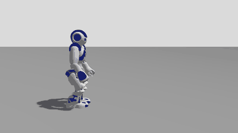

# NAO in Gazebo

[← Tutorials](README.md)

The NAO in Gazebo (gz-sim), in the 0.5 ms world. The physics model is `urdf/nao_gazebo.urdf`
(`make_gazebo_urdf.py`: primitive collisions, the links renamed where SDF needs it, no Gazebo
classic plugins). The looks are the NAO meshes of Gazebo Fuel (CC BY 4.0).

| Walking and turning, with the NAO meshes |
|:---:|
|  |
| stand_init → balance_stand → 0.06 m/s → 0.3 rad/s → stop |

## 1. Before starting

```bash
cd ~/ws/legged_ws
source install/setup.bash
export ROS_DOMAIN_ID=10
```

**Meshes (looks only).** `gaitos_description` downloads them when building, from the model
"NAO with Ignition position controller" of Gazebo Fuel (CC BY 4.0, attribution in
`robots/nao_description/MESHES_LICENSE.md`). With `-DGAITOS_FETCH_ASSETS=OFF` the simulation
is the same in Gazebo and the robot is drawn by its collision shapes.

## 2. Launch

```bash
ros2 launch gaitos_gazebo sim.launch.py robot:=nao                   # with the Gazebo window
ros2 launch gaitos_gazebo sim.launch.py robot:=nao headless:=true rviz:=true
```

The world is `empty_fine` (0.5 ms) by default for the NAO; the arguments are those of
[Go2 in Gazebo](go2_gazebo.md#2-launch). The NAO is spawned in `crouch`.

## 3. Modes, posture, walking, joints

The same ROS interface as [NAO in MuJoCo](nao_mujoco.md#3-modes):

```bash
ros2 service call /nao/mode/stand_init std_srvs/srv/Trigger
ros2 service call /nao/mode/balance_stand std_srvs/srv/Trigger
ros2 topic pub -r 10 /nao/cmd_vel geometry_msgs/msg/Twist "{linear: {x: 0.05}}"
ros2 topic pub --once /nao/joint_targets sensor_msgs/msg/JointState \
  "{name: [HeadYaw], position: [0.5], velocity: [1.0]}"
ros2 service call /nao/mode/crouch std_srvs/srv/Trigger
```

The servos are softer than in MuJoCo (`servo: {kp: 60, kd: 0.8}` in
`gaitos_gazebo/params/nao_gazebo.yaml`): stiffer ones make the feet bounce on the Gazebo
contacts. Verified: 0.8 m in 14 s walking, turning, standing still after.

## 4. A program for the real NAO (naoqi_driver) against this simulation

```bash
ros2 launch gaitos_naoqi_sim sim.launch.py simulator:=gazebo [headless:=true] [rviz:=true]
ros2 service call /gaitos/mode/stand_init std_srvs/srv/Trigger
ros2 topic pub --once /joint_angles naoqi_bridge_msgs/msg/JointAnglesWithSpeed \
  "{joint_names: [HeadYaw, HeadPitch], joint_angles: [0.5, 0.2], speed: 0.2}"
ros2 topic pub --once /cmd_vel geometry_msgs/msg/Twist "{linear: {x: 0.05}}"
ros2 topic pub --once /cmd_vel geometry_msgs/msg/Twist "{}"
ros2 topic pub --once /move_base_simple/goal geometry_msgs/msg/PoseStamped \
  "{header: {frame_id: base_footprint}, pose: {position: {x: 0.2}, orientation: {w: 1.0}}}"
```

See [NAO in MuJoCo](nao_mujoco.md#6-a-program-for-the-real-nao-naoqi_driver-against-this-simulation)
for the emulated topics.

## 5. Remake the clip

```bash
GIF_OPTS="--skip 13" CAM="0.3 -1.6 0.45 0 0.1 1.5708" docs/tools/record_gazebo.sh nao empty_fine \
  docs/media/nao_gazebo_walk.gif wait:17 mode:stand_init wait:4 mode:balance_stand wait:1 \
  vel:0.06,0,0 wait:9 vel:0,0,0.3 wait:4 stop wait:2
```
