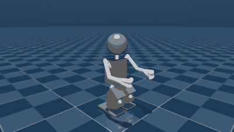
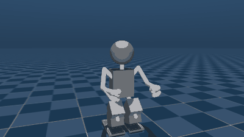

# NAO in MuJoCo

[← Tutorials](README.md)

The SoftBank / Aldebaran NAO (V6 motor limits) in MuJoCo, run inside the gaitos node. Model:
`mjcf/nao.xml`, made by `make_mjcf.py` from the physics URDF: primitive collisions (soles from
the FSR frames), a visual skeleton for the arms and fingers, no meshes (the NAO meshes are
under CC BY-NC-ND 4.0 and only optional, for RViz and Gazebo).

| Walking and turning (`locomotion`) | Head and arms over the controller (`joint_targets`) |
|:---:|:---:|
|  |  |
| crouch → stand_init → balance_stand → 0.06 m/s → 0.3 rad/s → stop | head and arms moved from outside, then stand_init takes them back |

## 1. Before starting

```bash
cd ~/ws/legged_ws
source install/setup.bash
export ROS_DOMAIN_ID=10
```

## 2. Launch

```bash
ros2 launch gaitos_mujoco sim.launch.py robot:=nao [rviz:=true]
```

The arguments are those of [Go2 in MuJoCo](go2_mujoco.md#2-launch). The NAO starts **in
`crouch`** (resting) and the cycle runs at 100 Hz, as the NAO motion loop.

## 3. Modes

| Mode | Controller | NAOqi | What it does |
|---|---|---|---|
| `damp`, `zero_torque` | joint | rest (stiffness 0) | passive joints |
| `crouch`, `stand_init`, `stand_zero` | joint | `goToPosture` | SRDF poses |
| `balance_stand` | stance | | standing, the body follows `goal_pose`; a `cmd_vel` starts `locomotion` |
| `locomotion` | gait | `move`, `moveTo` | kinematic walk: alternating steps, 2 cm sway, velocity loop |

```bash
ros2 service call /nao/mode/stand_init std_srvs/srv/Trigger      # NAOqi wakeUp
ros2 service call /nao/mode/balance_stand std_srvs/srv/Trigger
ros2 topic pub -t 3 -r 5 /nao/goal_pose geometry_msgs/msg/PoseStamped \
  "{header: {frame_id: torso}, pose: {position: {z: -0.01}}}"     # relative: 3 cm down in all
ros2 service call /nao/mode/crouch std_srvs/srv/Trigger          # NAOqi rest
```

## 4. Walking

```bash
ros2 service call /nao/mode/stand_init std_srvs/srv/Trigger
ros2 service call /nao/mode/balance_stand std_srvs/srv/Trigger
ros2 topic pub -r 10 /nao/cmd_vel geometry_msgs/msg/Twist "{linear: {x: 0.06}}"    # ≈0.06 m/s
ros2 topic pub -r 10 /nao/cmd_vel geometry_msgs/msg/Twist "{angular: {z: 0.3}}"    # ≈0.33 rad/s
```

Turning uses the HipYawPitch both legs share: the feet turn against each other, and the body
turns over the stance foot. Flat ground only; slower than NAOqi's walk.

## 5. Head, arms (and legs in the postures) from outside

`/nao/joint_targets` (`sensor_msgs/JointState`) moves joints over the controller: position, and
max speed in `velocity` (rad/s, optional). Head and arms are always allowed; any joint in
`stand_init`, `stand_zero`, `crouch`. A mode change takes them back.

```bash
ros2 topic pub --once /nao/joint_targets sensor_msgs/msg/JointState \
  "{name: [HeadYaw, LShoulderPitch], position: [0.8, -1.2], velocity: [1.5, 2.0]}"
```

## 6. A program for the real NAO (naoqi_driver) against this simulation

The ROS 2 interface of naoqi_driver in front of gaitos:

```bash
ros2 launch gaitos_naoqi_sim sim.launch.py simulator:=mujoco [rviz:=true]
ros2 service call /gaitos/mode/stand_init std_srvs/srv/Trigger    # NAOqi wakeUp
ros2 topic pub --once /joint_angles naoqi_bridge_msgs/msg/JointAnglesWithSpeed \
  "{joint_names: [HeadYaw, HeadPitch], joint_angles: [0.5, 0.2], speed: 0.2}"
ros2 topic pub --once /joint_angles naoqi_bridge_msgs/msg/JointAnglesWithSpeed \
  "{joint_names: [HeadYaw], joint_angles: [-0.3], speed: 0.2, relative: 1}"        # changeAngles
ros2 topic pub --once /cmd_vel geometry_msgs/msg/Twist "{linear: {x: 0.05}}"      # holds until zero
ros2 topic pub --once /cmd_vel geometry_msgs/msg/Twist "{}"
ros2 topic pub --once /move_base_simple/goal geometry_msgs/msg/PoseStamped \
  "{header: {frame_id: base_footprint}, pose: {position: {x: 0.3}, orientation: {w: 1.0}}}"   # moveTo
ros2 topic echo /joint_states
ros2 run tf2_ros tf2_echo odom base_footprint
```

| naoqi_driver | In simulation |
|---|---|
| `/joint_states` (50 Hz), TF of the links | 26 joints (RHipYawPitch from LHipYawPitch), robot_state_publisher at the root |
| `/odom`, TF `odom → base_link → base_footprint`, `/imu/torso` | the gaitos estimate |
| `/cmd_vel` | ALMotion.move: holds the velocity, only standing |
| `/joint_angles` | setAngles / changeAngles; names or Body, Head, LArm, RArm, LLeg, RLeg; speed fraction |
| `/move_base_simple/goal` | moveTo in `odom` or `base_footprint` |
| `/speech` | logged |

The gaitos node is in `/gaitos` (its modes and status). Not emulated: cameras, sonars, bumpers,
touch sensors, audio.

## 7. Remake the clips

```bash
docs/tools/record_mujoco.sh nao docs/media/nao_mujoco_walk.gif 0 18 "--distance 1.0 --azimuth 135 --elevation -15 --lookat-z 0.05" \
  --at 0.5 "mode stand_init" --at 3.5 "mode balance_stand" --at 4.5 "vel 0.06 0 0" --at 11 "vel 0 0 0.3" --at 15 "stop"
docs/tools/record_mujoco.sh nao docs/media/nao_mujoco_joints.gif 0 13 "--distance 0.9 --azimuth 160 --elevation -8 --lookat-z 0.1" \
  --at 0.5 "mode stand_init" --at 3.5 "mode balance_stand" --at 4.5 "target HeadYaw 0.8 1.5" \
  --at 4.5 "target HeadPitch -0.3 1.0" --at 5.5 "target LShoulderPitch -1.2 2.0" --at 5.5 "target LShoulderRoll 0.6 2.0" \
  --at 7 "target RShoulderPitch -1.2 2.0" --at 7 "target RShoulderRoll -0.6 2.0" --at 8.5 "target HeadYaw -0.8 1.5" \
  --at 10 "mode stand_init"
```
